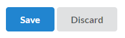

# mantic UI

| [Documentation](https://mantic-ui.ky-programming.de/fomantic) | [Github Repository](https://github.com/KY-Programming/mantic-ui) | [Support](https://support.ky-programming.de/) |

[Fomantic UI](https://fomantic-ui.com/) theme for [mantic UI](https://www.npmjs.com/package/@mantic-ui/angular) Angular components

Requires [@mantic-ui/angular](https://www.npmjs.com/package/@mantic-ui/angular)

## Example

A common button with some styling



````
<m-button primary (click)="...">
  Save
</m-button>
<m-button (click)="...">
  Discard
</m-button>
````

## Getting Started with Fomantic UI Theme

Install base package for angular and Fomantic UI theme

```
npm i @mantic-ui/angular @mantic-ui/fomantic-ui-angular 
```

### Import the theme components in your AppComponent

All components are standalone, import them where you use them.

app.component.ts

```
import { FomanticUiIconsLocalComponent, FomanticUiLatoLocalComponent, FomanticUiResetComponent, FomanticUiSiteComponent, FomanticUiThemeComponent } from '@mantic-ui/fomantic-ui-angular';

@Component({
    selector: 'app-root',
    imports: [FomanticUiThemeComponent, FomanticUiSiteComponent, FomanticUiResetComponent, FomanticUiLatoLocalComponent, FomanticUiIconsLocalComponent],
    templateUrl: './app.component.html'
})
export class AppComponent {}
```

### Apply the style in your AppComponent

app.component.html

```
<m-fomantic-ui-theme>
    <!-- Import common styles for site -->
    <m-fomantic-ui-site />
    <!-- Import reset to normalize values for CSS properties -->
    <m-fomantic-ui-reset />
    <!-- Import local hosted lato font -->
    <m-fomantic-ui-lato-local />
    <!-- Import local hosted Fomantic UI icons (not needed when you only use Font Awesome) -->
    <m-fomantic-ui-icons-local />
</m-fomantic-ui-theme>
```

`<m-fomantic-ui-theme dark>` switches the components to their inverted variants, `<m-fomantic-ui-theme auto>` follows the
dark mode setting of the operating system.

The theme is Fomantic UI 2.9.4 compiled from its LESS sources, plus the adjustments the mantic components need (icons
rendered by `m-icon`, Font Awesome support, the check mark of `m-checkbox`). The plain Fomantic UI CSS from a CDN lacks
those, so icons in buttons and inputs and the check mark of a checkbox are not styled with it.

### Configure package assets usage

angular.json

```
 "projects": {
    "<your-project-name>": {
      "architect": {
        "build": {
          "options": {
            "assets": [
              // Copy all package assets to app asset folder on build
              {
                "glob": "**/*",
                "input": "./node_modules/@mantic-ui/fomantic-ui-angular/assets",
                "output": "/assets/"
              }
            }
          }
        }
      }
    }
  }
```

## Credits

Original css from [Fomantic UI](https://fomantic-ui.com/)

## Work-in-progress

Currently we are not yet done. So please do not expect a perfect framework

If you have a issue, look in our [issue tracker on github](https://github.com/KY-Programming/mantic-ui/issues)

To support us fork our [github repository](https://github.com/KY-Programming/mantic-ui)

[Direct contact](https://support.ky-programming.de/) (German, English) via [email](https://email.support.ky-programming.de/), [WhatsApp](https://whatsapp.support.ky-programming.de/) or join our [Discord server](https://discord.mantic-ui.ky-programming.de/)
